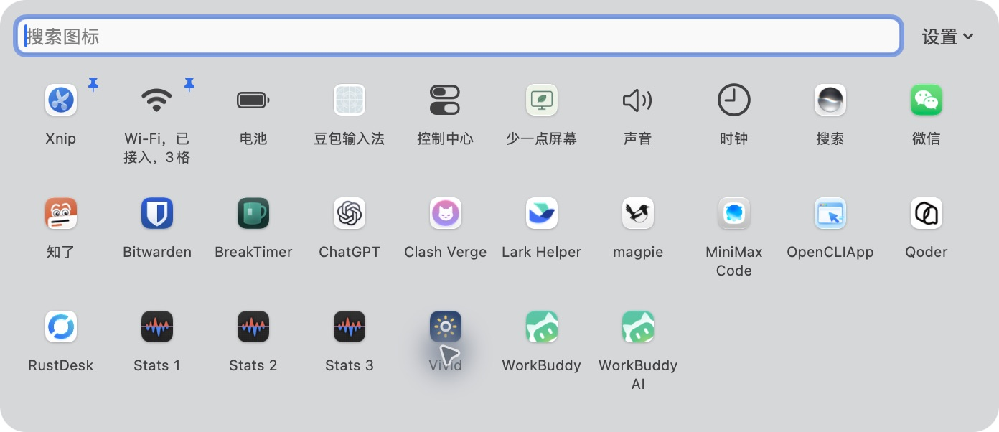

# 菜单栏面板

菜单栏图标太多，点开系统双箭头后还是放不下？

把它们放到下方面板里：**每行十个，自动换行；常用的放前面。**



## 功能

- **向下展开**：不再与左侧应用菜单争空间，项目多时可以滚动。
- **常用置顶**：右键选择“置顶”，按选择顺序排列，重启后保留。
- **名称完整**：长名称自动换行，不用猜省略号后面是什么。
- **搜索图标**：输入名称，快速找到要用的项目。
- **打开原菜单**：点击图标，调用对应应用自己的菜单或弹窗。

原生 Swift / AppKit / SwiftUI，无第三方依赖。全部在本机运行，不联网、不收集使用数据、不需要录屏权限。

## 使用

点击菜单栏的九宫格按钮展开；再次点击或按 `Esc` 收起。

右键图标可“置顶 / 取消置顶”。每次打开时自动更新图标列表，右上角“设置”提供辅助功能权限入口和退出操作。

首次使用需在「系统设置 → 隐私与安全性 → 辅助功能」允许“菜单栏面板”，以读取和操作其他应用的菜单栏项目。

## 构建与安装

当前提供源码，尚无开发者签名、公证的安装包。需要 Xcode 命令行工具，在项目目录运行：

```sh
./build.sh
```

将生成的 `build/菜单栏面板.app` 拖到「应用程序」后打开。

**已在 macOS 27.0.1、Apple Silicon 上验证。** 其他系统版本与 Intel Mac 尚未验证。

[详细使用与开发说明](doc/使用与开发.md)

## 当前边界

- 面板显示应用图标和名称，不复制菜单栏图标的实时数字或动画。
- 只列出运行中、通过辅助功能提供菜单栏入口的项目，不能保证读取所有应用。
- 原菜单或弹窗的位置由目标应用和 macOS 决定。
- 九宫格是独立入口，不替换系统双箭头，也不修改其他应用的显示设置。
